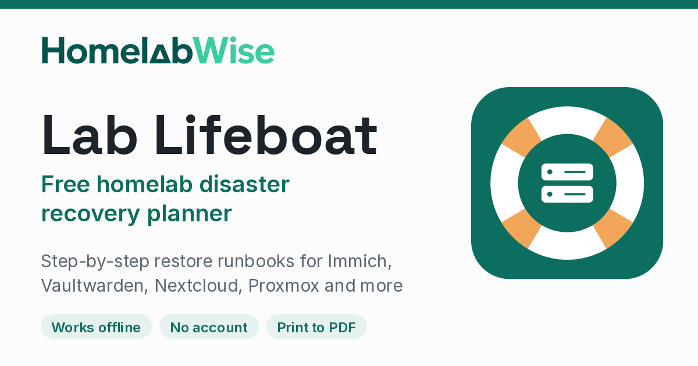

# Lab Lifeboat

Free offline restore runbook builder for homelabs: record what you run, in what order to bring it back, and where the keys live — then print the pack or save it as a PDF.



A hosted version is at [homelabwise.com/tools/lab-lifeboat](https://homelabwise.com/tools/lab-lifeboat/).

## Features

- Add **hosts** and **services**, then get a **restore order** for the pack.
- Records **where secrets live**, but never stores the secrets themselves. If a field looks like a password, key or token, it warns you.
- Warns when a service has **no backup location**, **no offsite copy**, or **no restore test** on record.
- Export as **PDF** (print), **Markdown** or **JSON**. Import a JSON file to move the pack to another device.
- **No account.** Your data stays in this browser on this device and is never uploaded.
- Works **offline** and can be installed as an app (PWA).

## Built-in version-pinned runbooks

Runbooks are pinned to the versions checked against official docs on 2026-11-12. Always restore the same version you backed up.

- Proxmox VE 9.2
- Vaultwarden 1.37.5
- Caddy 2.11.9
- Home Assistant 2026.11.1
- Nextcloud AIO v15.0.2
- Immich v3.4.1
- Paperless-ngx v3.4.2
- Jellyfin v12.4

You can also add a custom service and write your own steps.

## Self-host

Clone the repo, then serve the files as a static site. Any of these work:

```sh
git clone https://github.com/Slntlab/lab-lifeboat.git
cd lab-lifeboat
docker run -d -p 8080:80 -v "$PWD":/usr/share/nginx/html:ro nginx:alpine
```

Open [http://localhost:8080/](http://localhost:8080/).

Or build the image:

```sh
docker build -t lab-lifeboat .
docker run --rm -p 8080:80 lab-lifeboat
```

Or, with Python:

```sh
python3 -m http.server 8080
```

## Contributing

Pull requests are welcome, especially for new runbooks. Please keep secrets out of examples, avoid affiliate links, and add a test for any new service type.

## License

[MIT](LICENSE) © 2026 SLNT Labs
